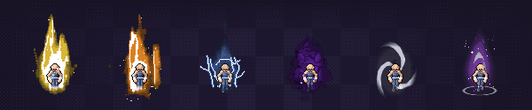
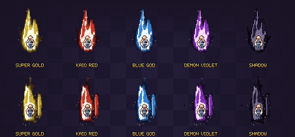
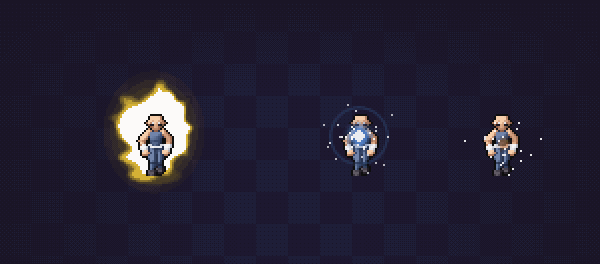
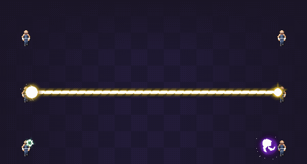
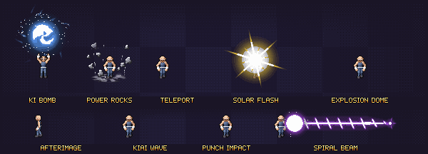
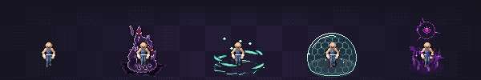

# Anime Ki Auras & Energy VFX — gallery

31 anime fighting-game effects for 2D games: six seamlessly looping power-up auras in back + front layers that wrap round your character, a power-up burst, ki blasts, an energy ball, a tileable beam with its head and tail, a spinning disc and charge-ups, 10 technique effects (a giant energy sphere held overhead, power-up rocks tearing out of the ground, an instant teleport, an afterimage dash, a kiai force push, a punch impact, a ground explosion dome, a blinding flash and a tileable spiral drill beam with its head), plus five Spellcraft effects (whirlwind, shadow shroud, gale hit, shield bubble, cursed). Greyscale sheets your engine tints to any colour, marker masks for multi-colour auras.

The figure in the previews is only a stand-in to show the scale (a 33 px tall character); it is not part of the pack.

## Changelog

* v1.1: fixed clipping at the PNG edge (the effects keep their v1.0 look in bigger cells: the auras and the burst share one 112 x 144 cell), seamless loops (the six auras share one 48-frame loop with no jump; `ki_charge` keeps v1.0's single ring, which now fades in and out instead of popping at the wrap), `beam_tail` (new: the beam's back end, so a stopped beam leaves the hands), `beam_charge` now 21 frames (charge 0-9 as in v1.0, then hold 10-17 and release 18-20), 10 new techniques (`ki_bomb`, `power_rocks`, `teleport`, `afterimage`, `kiai_wave`, `punch_impact`, `explosion_dome`, `solar_flash`, `spiral_beam_body`, `spiral_beam_head`) - 20 v1.0 effects + 11 new = 31
  * Changes from v1.0 (update your code):
    * **New cells and anchors** for every restored ki effect that was cut off or re-anchored: the six auras and `aura_burst` 96x96 with the feet at (48, 82) -> 112x144 with the feet at (56, 105), `ki_blast` 32x32 (16, 16) -> 40x32 (21, 16) (the ball's centre, where v1.0 drew it), `ki_blast_hit` 32x32 -> 40x40 (20, 20), `beam_head` 48x32 (24, 16) -> 56x48 (0, 24), `ki_charge` 48x48 -> 48x56, `beam_charge` anchor (24, 24) -> (26, 24) (see the table below)
    * **New frame counts**: the auras 16 / 24 -> 48 (one shared seamless loop), `energy_ball` 12 -> 24 (one full turn of its swirl), `beam_charge` 10 -> 21 (`segments`: charge 0-9 = v1.0's frames, hold 10-17 a loop drawn over the beam's root while it fires, release 18-20)
    * **`beam_head`**: its anchor is now the join on its left edge (v1.0: its centre), and its neck is `beam_body`'s band, so the assembled beam no longer steps where the body meets the head
    * **`aura_wind`** turns its arms 17 % faster (7 turns per 48-frame loop; v1.0's speed repeated every 8 frames)
    * **`beam_tail`** is a new effect (the beam's back end)
* v1.0: first release (20 effects)

## Upgrading from v1.0

The 15 ki effects of v1.0 keep their look; these frame counts, cells and anchors changed (anchor = cell pixels from the top-left; `beam_head`'s anchor moved from its centre to the join). The five Spellcraft effects are unchanged.

| id | v1.0 frames | v1.0 cell | v1.0 anchor | v1.1 frames | v1.1 cell | v1.1 anchor | note |
|---|---|---|---|---|---|---|---|
| `aura_ki` | 24 | 96x96 | (48, 82) | 48 | 112x144 | (56, 105) | the auras' shared cell and 48-frame loop |
| `aura_blaze` | 24 | 96x96 | (48, 82) | 48 | 112x144 | (56, 105) | the auras' shared cell and 48-frame loop |
| `aura_lightning` | 16 | 96x96 | (48, 82) | 48 | 112x144 | (56, 105) | the auras' shared cell and 48-frame loop |
| `aura_dark` | 24 | 96x96 | (48, 82) | 48 | 112x144 | (56, 105) | the auras' shared cell and 48-frame loop |
| `aura_wind` | 16 | 96x96 | (48, 82) | 48 | 112x144 | (56, 105) | the auras' shared cell and 48-frame loop |
| `aura_sparkle` | 24 | 96x96 | (48, 82) | 48 | 112x144 | (56, 105) | the auras' shared cell and 48-frame loop |
| `aura_burst` | 12 | 96x96 | (48, 82) | 12 | 112x144 | (56, 105) | the auras' shared cell |
| `ki_blast` | 8 | 32x32 | (16, 16) | 8 | 40x32 | (21, 16) | same drawing; the anchor is now the ball's centre |
| `ki_blast_hit` | 6 | 32x32 | (16, 16) | 6 | 40x40 | (20, 20) | bigger cell, the hit point centred |
| `energy_ball` | 12 | 64x64 | (32, 32) | 24 | 64x64 | (32, 32) | one full turn of the swirl |
| `beam_head` | 8 | 48x32 | (24, 16) | 8 | 56x48 | (0, 24) | anchor moved from the head's centre to the join (its left edge, on the beam axis) |
| `beam_body` | 8 | 32x32 | (16, 16) | 8 | 32x32 | (16, 16) | unchanged |
| `beam_charge` | 10 | 48x48 | (24, 24) | 21 | 48x48 | (26, 24) | segments charge / hold / release |
| `energy_disc` | 8 | 32x32 | (16, 16) | 8 | 32x32 | (16, 16) | unchanged |
| `ki_charge` | 12 | 48x48 | (24, 24) | 12 | 48x56 | (24, 24) | bigger cell; the ring fades in / out instead of popping |

## Format

* **One folder per effect** in `effects/`, one catalog `effects.json` (frames, loop flag, cell, anchor, layers, masks, presets, sheets, strips and preview GIFs for every effect; paths relative to the pack root).
* **Tintable**: the ki effects and the techniques are greyscale + alpha (R = G = B, the brightest pixel of every effect is white); the colour is `grey x tint` in the engine (`modulate` in Godot). The previews also push the brightest greys towards white, as an additive blend shows the core.
* **Sheets**: `<id>_sheet.png` has 4 identical columns and one frame per row (pick any column), `<id>_strip.png` the frames side by side, `<id>_fNN.png` single frames. 20 fps (50 ms per frame).
* **Nothing is cut off**: no effect touches the edge of its cell (only the tiling ends of the beams do).
* **Anchor** (cell pixels from the top-left, also in the tables below and in `effects.json`): the auras and the burst share a 112x144 cell with the character's **feet at (56, 105)** (swap auras freely; `power_rocks` uses the same cell and feet, so it layers with any aura), the Spellcraft effects use a 96x96 cell with the feet at (48, 82) - put the anchor on the character's position and it fits a character about 33 px tall; the ki blast's anchor is its ball at (21, 16) with the tail to the left (flip it for the other side), the beam head's is the join (0, 24), the beam tail's its join (32, 16) on its right edge, the beam charge-up's the charge point (26, 24); `ki_blast_hit`, `energy_ball`, `beam_body`, `energy_disc`, `spiral_beam_body` are centred in their cell; each technique's note names its anchor (the feet, the hit point, ground zero or the join) and `points` gives further anchor points (`dash_start`, `face`, `hands`, `origin`, `sphere`).
* **Aura layers**: every looping aura comes as `<id>_back_*` (draw it behind the character) and `<id>_front_*` (draw it over the character: the flames, arcs, streaks and sparks in front of the figure) with the same frame index, so the aura wraps round the figure. The bottom of an aura closes round the character's feet a few px below them (up to 18 px, `aura_blaze`), with `aura_sparkle`'s halo ring on the ground; the flame tips rise up to 102 px over the feet (`aura_blaze`).
* **Seamless aura loops**: the six auras share one loop of 48 frames (2.4 s at 20 fps). Every motion in it completes a whole number of cycles and the flames, sparks and streaks alive in the last frame carry on into the first, so the last -> first step looks like any other frame and nothing restarts or pulses: play it for as long as the character is powered up. They all have the same length, so you can swap auras in sync. `aura_burst` is one layer (12 frames, one-shot) - play it once when the aura starts.
* **Aura masks**: `<id>_<layer>_mask_sheet.png` / `_mask_strip.png` mark the parts of the aura (yellow = white-hot core, red = flame, green = darker rim, blue = sparks, licks and haze; in `aura_lightning` the bolts' white cores are marked core and their thin glow flame) so an engine can colour them separately. `effects.json` names the four regions `core`, `flame`, `rim` and `sparks`; as in v1.0 the preset keys are `head` (core), `body` (flame), `legs` (rim) and `feet` (sparks): `masks.marker_colors` gives each key's mask colour (head = yellow 255,255,0, body = red 255,0,0, legs = green 0,255,0, feet = blue 0,0,255) and the five region presets (super_gold, kaio_red, blue_god, demon_violet, shadow) in `masks.presets` give a colour per key - a pixel whose mask colour is `marker_colors[key]` gets `grey x presets[name][key]`; previewed as `effects/<id>/preview/<id>_preset_<name>.gif`.
* **Techniques**: `ki_bomb`, `power_rocks`, `teleport` come in back + front layers with marker masks and presets like the auras; the looping ones are seamless 8 or 48-frame loops (`ki_bomb` and `power_rocks` loop with the auras), the rest are one-shots that start small and end on an empty frame. `teleport` is two one-shots in one strip (`segments.vanish` / `segments.appear`, with the frames to hide and show the character); `afterimage` and `kiai_wave` face right (flip them for the other side).
* **Spellcraft effects**: `native/` in their original colours and `grey/` tintable, each with `_back` / `_front` layers, a merged sheet and single frames in `frames/`; the looping ones are seamless 40-frame loops (2 s).
* **Beam**: `beam_body` tiles along x (32 px, no seam), `beam_head` is the front end: draw it right after the last whole body tile (its x = 0 continues the body), with the same frame index for both. Start the beam at `beam_charge`'s anchor (the charge point, on the beam axis); while it fires draw `beam_charge`'s `segments.hold` frames (a loop) over the root, after the beam. When it stops, play `segments.release` (the sphere collapses, round) and let the beam's back end leave the hands: draw `beam_tail` (its x = 32 continues the body's x = 0, same frame index; the band narrows to a point) right before the first body tile and move it towards the head over a few frames, cutting the body tiles behind it; when it reaches the head, end the beam with `ki_blast_hit` at the head (or fade the head out) - the beam never ends in a flat cut. Without a beam play `segments.charge` then `segments.release`. `spiral_beam_body` / `spiral_beam_head` work the same way (body tiles along x, the head right after the last tile, same frame index).

## Auras (back + front layers, loop)

| id | frames | cell | anchor | loop | notes | preview |
|---|---|---|---|---|---|---|
| `aura_ki` | 48 | 112x144 | (56, 105) | yes | compact flame hugging the figure: white-hot core, darker rim, spiky tongues, licks and dithered sparks |  |
| `aura_blaze` | 48 | 112x144 | (56, 105) | yes | power-up form: bigger, spikier, faster flame |  |
| `aura_lightning` | 48 | 112x144 | (56, 105) | yes | serpentine arcs crawling up the flanks over a faint flame, flickering (re-rolled every frame) |  |
| `aura_dark` | 48 | 112x144 | (56, 105) | yes | evil ki: dense, slow, heavy smoke with black veins |  |
| `aura_wind` | 48 | 112x144 | (56, 105) | yes | spiral streaks racing round the body |  |
| `aura_sparkle` | 48 | 112x144 | (56, 105) | yes | calm glow with rising sparks, twinkling stars and a halo on the ground |  |

## Power-up

| id | frames | cell | anchor | loop | notes | preview |
|---|---|---|---|---|---|---|
| `aura_burst` | 12 | 112x144 | (56, 105) | one-shot | one-shot power-up explosion (flash, ring racing out, flame tongues, dust), same cell and anchor as the auras |  |
| `ki_charge` | 12 | 48x56 | (24, 24) | yes | loop centred on the figure's chest: particles falling inward, a pulsing core, a faint ring contracting into it; anchor = the core's centre (put it on the chest) |  |
| `beam_charge` | 21 | 48x48 | (26, 24) | one-shot | charge-up at the hands; anchor = the charge point = the beam's root on its axis. segments: charge (frames 0-9, one-shot: particles stream into the hands, the sphere grows and flares), hold (10-17, a seamless loop: the flared sphere held while the beam fires - draw it over the beam's root, after the beam), release (18-20, one-shot: it fades out while the beam's tail - beam_tail - leaves the root). Without a beam play 0-9 then 18-20 |  |

## Projectiles, beams and impacts

| id | frames | cell | anchor | loop | notes | preview |
|---|---|---|---|---|---|---|
| `ki_blast` | 8 | 40x32 | (21, 16) | yes | projectile flying right; anchor = the ball's centre, tail to the left (flip it for the other side) |  |
| `ki_blast_hit` | 6 | 40x40 | (20, 20) | one-shot | impact, centred on the hit point (one-shot: a flash, a ring and fragments flying off; the last frame is empty) |  |
| `energy_ball` | 24 | 64x64 | (32, 32) | yes | big swirling energy sphere with orbiting sparkles, centred |  |
| `beam_head` | 8 | 56x48 | (0, 24) | yes | beam front (right end); anchor = the join on the beam's axis, its left edge: its x = 0 continues beam_body, so draw it right after the last whole body tile, with the same frame index (the cell is taller than the body's for the cap's rays; the anchors line the axes up) |  |
| `beam_body` | 8 | 32x32 | (16, 16) | yes | beam segment, tiles along x with no seam (beam axis y = 16; the stripes flow right); same frame index as the head and tail. The beam starts at beam_charge's anchor (the charge point, on the beam axis): tile back from the head and cut the last tile there, then draw beam_charge's hold frames over that root (its flare hides the cut). When it stops, beam_tail is the back end that leaves the hands |  |
| `beam_tail` | 8 | 32x32 | (32, 16) | yes | beam back end (left end) for a beam that has stopped firing; anchor = the join on the beam's axis, its right edge: its x = 32 continues beam_body's x = 0 (its right 16 columns are the body tile), so draw it right before the first body tile, with the same frame index; the band closes in a rounded, fading end. Move it (and cut the body tiles behind it) towards the head while beam_charge plays its release; when it reaches the head, end the beam with ki_blast_hit at the head (or fade the head out) |  |
| `energy_disc` | 8 | 32x32 | (16, 16) | yes | spinning razor disc, centred |  |

## Techniques

| id | frames | cell | anchor | loop | notes | preview |
|---|---|---|---|---|---|---|
| `ki_bomb` | 48 | 112x112 | (56, 109) | yes | giant energy sphere held over the raised hands, loop: the surface swirls, soft streaks and sparks of energy flow in from all around. anchor = the figure's feet; points.hands = where the raised hands touch the sphere (37 px above the feet), points.sphere = the sphere's centre (radius 23). To throw it, move the sprite by points.sphere and play explosion_dome where it lands |  |
| `power_rocks` | 48 | 112x144 | (56, 105) | yes | power-up debris, loop: rocks tear out of the ground, float up round the figure and crumble, pebbles rise, dust churns at the feet, ki glows through ground cracks. Same cell and anchor as the auras (112 x 144, the figure's feet at [56, 105]) and the same 48-frame loop, so it layers with any aura at the same offset (back under the aura's back, front over the aura's front). Tint white for grey stone (preview power_rocks_white.gif) or with the aura's colour for ki-lit rocks; the mask presets colour the rocks too |  |
| `teleport` | 20 | 64x112 | (32, 100) | one-shot | instant teleport, one-shot: vanish (frames 0-9: a light pillar flares over the figure, thins to a line and zips away upward, a glowing afterimage flickers and erodes away, sparks) - hide the figure from frame 2; appear (frames 10-19, at the destination) - show the figure again from frame 17. anchor = the figure's feet |  |
| `afterimage` | 12 | 96x48 | (78, 39) | one-shot | speed dash, one-shot, facing right (flip for left): speed streaks at head and foot height, soft half-alpha ghosts of a side-on runner fading one after another, dust puffs. anchor = the figure's feet where the dash ends; the figure moves in from points.dash_start (60 px to the left) during frames 0-2. Draw it behind the figure |  |
| `kiai_wave` | 14 | 96x64 | (18, 49) | one-shot | invisible force push (kiai), one-shot, facing right (flip for left): soft broken shockwave arcs racing out from the hands, a dust burst along the ground, pebbles. anchor = the figure's feet; points.origin = where the push leaves the hands. Draw it over the figure |  |
| `punch_impact` | 8 | 64x48 | (32, 26) | one-shot | melee hit, one-shot: flash, star burst, a short shockwave ring, speed dashes and sparks. anchor = the hit point (e.g. the target's chest, 20 px above its feet) |  |
| `explosion_dome` | 23 | 176x96 | (88, 69) | one-shot | big ki explosion, one-shot: white flash, a dome of energy rising and eroding, a ground shockwave ring with a dust skirt, debris on arcs, dark smoke fading out; only the last frame is empty. anchor = ground zero (on the ground) |  |
| `solar_flash` | 18 | 112x96 | (56, 76) | one-shot | blinding flash from the face, one-shot: rays, a cross glint and a white-out bloom that holds and fades. anchor = the figure's feet; points.face = the flash's centre (26 px above the feet). Draw it over the figure |  |
| `spiral_beam_body` | 8 | 32x32 | (16, 16) | yes | drilling beam segment, tiles along x with no seam (beam axis y = 16; the coil spins and the stripes flow right, 2 px a frame like beam_body); same frame index as spiral_beam_head. Start it at beam_charge's anchor like beam_body |  |
| `spiral_beam_head` | 8 | 64x32 | (0, 16) | yes | drilling beam front (right end): coil and core taper together into a drill point. anchor = the join on the beam's axis, its left edge: its x = 0 continues spiral_beam_body, so draw it right after the last whole body tile with the same frame index |  |

## Spellcraft effects (native colours + tintable grey)

| id | frames | cell | anchor | loop | notes | preview |
|---|---|---|---|---|---|---|
| `whirlwind` | 20 | 96x96 | (48, 82) | one-shot | one-shot spin slash round the fighter (melee); anchored at the feet like the auras (its own 96 x 96 cell, feet at (48, 82)) |  |
| `shadow_shroud` | 40 | 96x96 | (48, 82) | yes | loop; a breathing cloak of shadow with blinking eyes, dark pool at the feet |  |
| `gale_hit` | 20 | 96x96 | (48, 82) | one-shot | one-shot wind impact on the fighter (hit point at the chest); fine as one layer |  |
| `shield_bubble` | 40 | 96x96 | (48, 82) | yes | loop; translucent hex-plated bubble round the fighter, a ripple sweeping over it |  |
| `cursed` | 40 | 96x96 | (48, 82) | yes | loop; sigil-eye over the head, barbed rune chain, wisps and void motes |  |
